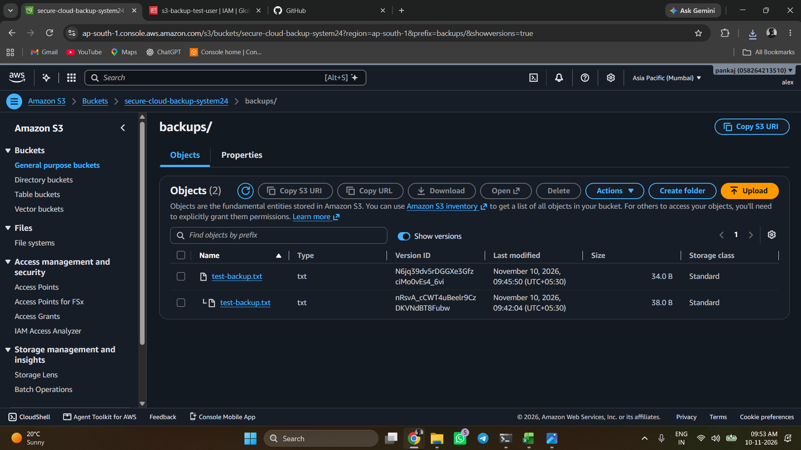

# AWS S3 Backup and Recovery System

A hands-on AWS project demonstrating secure backup uploads, IAM permissions, S3 Versioning, and recovery of previous object versions.

## Architecture

```text
Windows Workstation
       |
       | AWS CLI
       v
IAM User
(s3-backup-test-user)
       |
       | s3:PutObject
       v
Amazon S3 Bucket
(secure-cloud-backup-system24)
       |
       v
backups/test-backup.txt
       |
       +---- Latest Version
       |
       +---- Previous Version
                    |
                    v
              Recovery
```

## AWS Services & Configuration

| Component | Configuration |
|---|---|
| AWS Region | ap-south-1 (Mumbai) |
| Storage | Amazon S3 |
| Bucket | `secure-cloud-backup-system24` |
| Backup Prefix | `backups/` |
| IAM User | `s3-backup-test-user` |
| Access Method | AWS CLI |
| Versioning | Enabled |

## Project Implementation

### 1. S3 Bucket Setup
- Created an S3 bucket.
- Enabled Bucket Versioning.
- Created the `backups/` prefix.
- Used S3 Standard storage.

### 2. IAM Configuration
Created a dedicated IAM user instead of using root credentials.

Configured the intended upload-only permission:

```json
{
  "Version": "2012-10-17",
  "Statement": [
    {
      "Effect": "Allow",
      "Action": "s3:PutObject",
      "Resource": "arn:aws:s3:::secure-cloud-backup-system24/backups/*"
    }
  ]
}
```

This policy restricts uploads to the `backups/` prefix. The live IAM policy should be checked in the AWS Console before claiming it matches this example.

### 3. AWS CLI Upload

Configured AWS CLI on Windows PowerShell:

```powershell
aws configure
aws sts get-caller-identity
```

Created and uploaded a test backup:

```powershell
Set-Content .\test-backup.txt "test backup file"

aws s3 cp .\test-backup.txt s3://secure-cloud-backup-system24/backups/
```

The upload was successful.

### 4. S3 Versioning & Recovery

- Modified the local test file.
- Uploaded it again using the same S3 object key.
- Confirmed that S3 retained two object versions.
- Downloaded the previous version through the S3 Console.
- Opened and inspected the recovered file.

**Result:** Successfully tested recovery of an older S3 object version.

## Project Evidence

The screenshot below shows the S3 object versions in the AWS Console.



## Troubleshooting

| Issue | Resolution |
|---|---|
| `NoSuchBucket` | Corrected the bucket name. |
| `AccessDenied` for upload | Added the required upload permission. |
| `AccessDenied` for listing | Expected because `s3:ListBucket` was not granted. |

## Key Learnings

- IAM users and least-privilege permissions.
- AWS CLI configuration and S3 uploads.
- Difference between `s3:PutObject` and `s3:ListBucket`.
- S3 Bucket Versioning.
- Downloading and recovering previous object versions.

## Future Improvements

- Automate scheduled backups.
- Configure S3 Lifecycle rules.
- Add backup monitoring and notifications.
- Explore Cross-Region Replication.

## Conclusion

Successfully built and tested a basic AWS S3 backup and recovery workflow using IAM, AWS CLI, and S3 Versioning.

This project demonstrates practical understanding of cloud storage, access control, backup versioning, and recovery.
